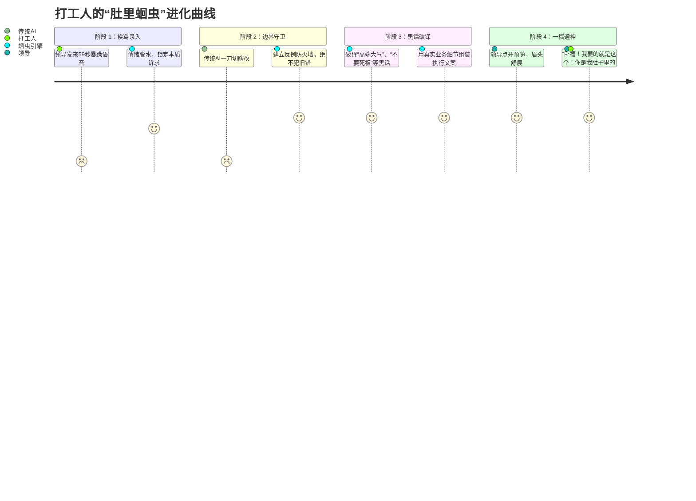

# BossAlign (蛔虫引擎 / Roundworm) 🐛⚡

> **把领导的每一次夺命吐槽，变成下一次“一稿过审”的强化学习。**  
> *让领导惊呼：“卧槽……我要的就是这种感觉，你小子简直是我肚子里的蛔虫！”*

[](LICENSE)
[](https://www.python.org/downloads/)
[](CONTRIBUTING.md)
[](#)

[English Version (README_EN.md)](README_EN.md) | [核心白皮书 (docs/)](docs/) | [虚构案例 Demo](examples/skypulse_drone/)

---

## 💥 每一个打工人和 AI 创作者的窒息瞬间

你一定经历过这样的地狱循环：

1. **你花了一整天，用 AI 生成了一版方案/视频脚本**，满心欢喜发给老板。
2. **老板点开 3 秒，发来一条 59 秒暴躁语音**：  
   > *“这写的什么狗屁？太死板了！一股浓浓的 AI 味！我要的是高端、有质感，但不要老式宣传片那一套！接地气点，懂不懂？重新改！”*
3. **你抓耳挠腮，把老板的话原封不动喂给 ChatGPT**：*“请改得高端、有质感、不要老式宣传片”*。
4. **第二版交上去，老板彻底拍桌子**：  
   > *“谁让你把我刚才说的真实应用全删了？！你到底长没长脑子？！”*

---

### 为什么普通的 AI 越改越烂？

大模型的致命缺陷在于 **“缺乏反例边界”** 和 **“过度矫枉过正（Over-fitting）”**：
- 老板说：“这篇不要讲太多工厂细节”，普通 AI 下一篇就**彻底把工厂删光**；
- 老板说：“文案要有网感”，普通 AI 立刻塞满**过时的烂梗**；
- 大老板和二老板意见冲突，AI 更是**直接精神分裂**。

**老板并不是故意挑刺，老板是在用他多年的商业直觉做“模糊审美决策”；而你的 AI，缺乏一套捕获这种直觉的工程对齐系统。**

---

## 🚀 欢迎来到 BossAlign（蛔虫引擎）

`BossAlign` 不是一个简单的 Prompt，也不是浮于表面的润色工具。  
它是**一套专为复杂审批环境设计的“人类决策者在环（Boss-in-the-Loop）偏好对齐框架”**。

它把领导的每一次微信吐槽、红字批注、会议争吵，像 Git 提交一样记录下来，提炼出**“适用场景与反例边界”**，并在交稿前启动**“影子老板沙箱”**内部挑刺。



---

## 🛠️ 四大核武器机制

### 1. 情绪脱水器 (Emotion De-noiser)
领导发火的语音里，80% 是情绪发泄，20% 才是有效信息。  
框架自动过滤 *“这什么玩意”、“到底懂不懂”* 等噪音，精准捕获：
- **核心诉求**：压缩概念叙事，强化实际应用场景。
- **业务锚点**：保留测试数据与对比动作，删除空洞口号。

### 2. 反例防火墙与边界守卫 (Negative Boundary Guard) —— 核心灵魂！
**这是防止 AI 犯蠢的关键。** 任何一条原则被录入时，必须强制生成三要素：
- **核心主张**：本篇减少宏观工艺介绍。
- **适用场景**：面向采购商的产品选型介绍篇。
- **反例边界（严禁跨界乱套）**：研发实力篇与出海交付篇**严禁**删减工艺细节！

### 3. 老板黑话编译器 (Boss Dialect Compiler)
破译中国式领导的典型高频模糊黑话：
| 领导黑话 | 传统 AI 的蠢改 | 蛔虫引擎的精准解码 |
|---|---|---|
| **“高端一点”** | 狂堆成语、“奢华典雅、尊贵非凡” | **声画留白** + **实物微距特写** + **克制不说满话** |
| **“要有00后网感”** | 硬塞网络热梗、自嗨说唱 | **加快剪辑节奏** + **声画卡点** + **拒绝假大空老播音腔** |
| **“我只是说个意思”** | 逐字照抄领导的原话，导致语病百出 | **领会战略骨架**，AI 负责补齐连贯可执行的业务动线 |

### 4. 交付净室过滤器 (Clean-Room Sanitizer)
内部学习再深刻，对外交付必须**不留一丝马脚**。
- 彻底物理清洗所有内部标签（如 `[根据王总 feedback-042 修改]`）；
- 导出的 Word / Excel / 脚本干干净净，就像你通宵苦思冥想亲自写出来的一样纯粹。

---

## ⚡ 30 秒极速体验

### 安装
```bash
pip install bossalign
# 或者克隆本仓库
git clone https://github.com/your-repo/bossalign.git
cd bossalign && pip install -e .
```

### 1. 录入一次领导的“夺命吐槽”
```bash
bossalign ingest \
  --reviewer "Boss_Victor" \
  --raw "这段太假了！什么匠心智造都是废话，我要看实际能飞多久、抗几级风，但别搞成说明书！" \
  --context "天脉无人机篇02_性能展示"
```
系统将自动生成标准化的 `feedback_event` 并推导反例边界：
```json
{
  "event_id": "EVT-202610-001",
  "reviewer": "Boss_Victor",
  "intent": "用具体抗风实测与续航代替抽象匠心宣传",
  "boundary": {
    "applicable_to": ["性能展示篇", "硬核评测篇"],
    "counter_example": "严禁在品牌故事篇中纯报参数，故事篇仍需保留品牌温度"
  }
}
```

### 2. 生成新方案并运行“影子老板沙箱”
```bash
bossalign generate \
  --topic "篇03_天脉无人机全天候作业实力" \
  --persona "Boss_Victor" \
  --output "output/script_v1.md"
```
沙箱自动拦截旧错，并在终端输出：
```text
[SandBox] 正在运行影子老板审阅...
[PASS] 未发现假大空总结词汇
[PASS] 抗风等级与续航实测数据已锚定真实测试报告
[PASS] 叙事节奏检测：每镜字数与停顿已对齐 Boss_Victor 紧凑偏好
[CLEAN] 净室清洗完成，内部元数据已擦除！
交付文件已生成：output/script_v1.md
```

---

## 📂 项目结构

```text
bossalign/
├── bossalign/               # Python 核心引擎代码
│   ├── parser.py            # 情绪脱水与反馈结构化解析
│   ├── boundary.py          # 反例边界守卫与旧错回查
│   ├── sandbox.py           # 交付前影子老板审查沙箱
│   └── sanitizer.py         # 净室导出清洗器
├── docs/                    # 核心设计白皮书
│   ├── 01_boundary_guard.md # 论“反例边界”如何终结大模型一刀切
│   ├── 02_evidence_ladder.md# 证据阶梯：原话、事实与推断隔离
│   └── 03_clean_room.md     # 净室原则：职场生存交付法则
└── examples/                # 标杆级虚构案例库
    └── skypulse_drone/      # SkyPulse 天脉智航无人机宣传片一稿过审实录
```

---

## 🛡️ 隐私与数据安全（严格脱敏承诺）

本开源项目的所有演示数据、文档案例与规则样本均为**完全虚构的工业示例**（如智能硬件制造 `SkyPulse`）。  
**绝不包含任何真实商业机密、真实人物姓名、真实产品参数或真实录音资产。**

---

## 🤝 贡献与共建

如果你也曾在改稿的地狱里被折磨得痛不欲生，欢迎加入我们！
- 提交一个你老板的经典黑话解码器（PR）
- 补充更多行业的虚构对齐案例（政企方案、广告公关、技术白皮书）

**如果这个项目帮你在领导面前挽回过尊严，别忘了点亮右上角的 🌟 Star！**
