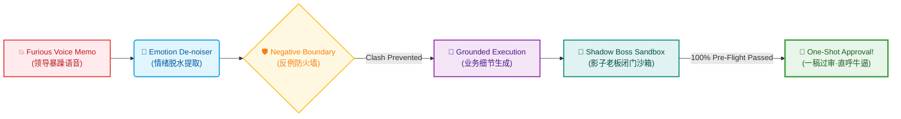
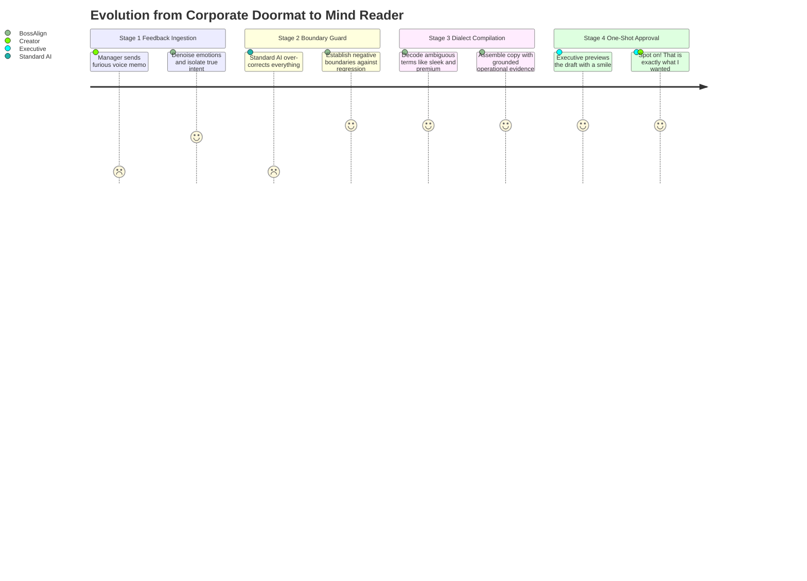

# BossAlign (Codename: Roundworm / 蛔虫引擎) 🐛⚡

> **Turn ruthless managerial feedback into one-shot approvals.**  
> *Make your stakeholders exclaim: "Holy crap, that's EXACTLY what I wanted! How did you read my mind?!"*  
> *(把领导的每一次夺命吐槽，变成下一次“一稿过审”的强化学习。让领导惊呼：“卧槽，你就是我肚子里的蛔虫！”)*

<p align="center">
  <b>English</b> | 
  <a href="README_CN.md"><b>📖 简体中文文档</b></a> | 
  <a href="docs/01_boundary_guard_en.md">Architecture Whitepapers</a> | 
  <a href="examples/skypulse_drone/output_script_en.md">Benchmark Showcase</a>
</p>

<p align="center">
  <a href="LICENSE"></a>
  <a href="https://www.python.org/downloads/"></a>
  <a href="CONTRIBUTING.md"></a>
  <a href="#"></a>
  <a href="#"></a>
</p>

---

## 🔄 The End-to-End Alignment Workflow (系统运转全景)



---

## 💥 The Universal Creator Nightmare (打工人的窒息循环)

Every professional and AI creator has suffered through this brutal loop:

1. **You spend hours using LLMs to craft a pitch/script/proposal**, feeling confident.
2. **Your manager reviews it for 3 seconds and drops a furious 60-second voice memo**:  
   > *"What on earth is this? It's so stiff and reeks of generic AI fluff! I want premium and sleek, but not the boring old corporate video style! Make it punchy, you get me?! Redo it!"*
3. **You frantically feed the exact words into ChatGPT**: *"Make it premium, sleek, and not a boring corporate video."*
4. **You submit V2, and your manager explodes**:  
   > *"Who told you to strip away all the actual engineering benchmarks I asked for?! Are you even paying attention?!"*

### Why Standard AI Fails in Real Decision-Making
Standard LLMs suffer from severe **Over-fitting** and **Lack of Negative Boundary Constraints**:
- When a boss says *"Don't overcomplicate the factory tour in this 30s video"*, the AI completely erases manufacturing credentials in every future document.
- When a boss asks for *"a modern vibe"*, the AI injects cheap internet memes into a B2B enterprise deck.
- When two senior stakeholders disagree, the AI hallucinates into complete paralysis.

> **The Insight**: Your executive is not being erratic—they are making intuitive, multi-variable aesthetic decisions. Your AI simply lacks an engineering framework to align with that intuition.

---

## 🚀 Welcome to BossAlign (蛔虫进化之路)

`BossAlign` is not just another prompt template or superficial rewriter.  
It is a **production-grade "Boss-in-the-Loop" Preference Alignment Framework** designed for complex organizational review pipelines.

It tracks managerial feedback like Git commits, synthesizes strict **Applicability Scope & Negative Boundaries**, and runs a **Pre-Flight "Shadow Boss" Sandbox** before you hit send.



---

## 🛠️ Four Core Architectural Pillars (四大核武器机制)

### 1. 🧪 Emotion De-noiser (情绪脱水器)
Executive rants are 80% venting and 20% critical signal.  
`BossAlign` strips conversational noise and captures:
- **Core Intent**: Shift from abstract corporate storytelling to grounded operational proof.
- **Evidence Anchor**: Retain empirical testing data; ban unverified superlative claims.

### 2. 🛡️ Negative Boundary Guard (反例防火墙与边界守卫)
**The #1 reason AI fails in organizations is unchecked generalization.**  
Every learned preference rule must strictly define:
- **Core Directive**: Omit macro assembly-line walkthroughs.
- **Applicable Scope**: B2B product showcase overview clips.
- **Negative Boundary (Strict Prohibition)**: **NEVER** apply this rule to R&D capability or QA assurance documents!

### 3. 📖 Boss Dialect Compiler (老板黑话编译器)
Decodes ambiguous corporate speak into actionable creative execution:

| Executive Slang (领导黑话) | Naive LLM Mistake (传统AI蠢改) | BossAlign Translation (蛔虫引擎精准解码) |
|---|---|---|
| **"Make it premium" (高端一点)** | Piles on flashy adjectives like *"luxurious, unparalleled"* | **Cinematic breathing pauses** + **Macro product closeups** + **Restrained, verifiable claims** |
| **"Make it appeal to Gen-Z" (有网感)** | Stuffs cringe memes, hashtags, and amateur rap | **Dynamic editing rhythm** + **Diegetic sound sync** + **Eliminates monotone broadcast narration** |
| **"I'm just giving you the rough idea" (我只说个意思)** | Copies the boss's broken sentences verbatim | **Extracts strategic skeleton**, LLM finishes continuous delivery flow |

### 4. 🧼 Clean-Room Sanitizer (交付净室过滤器)
Deep tracking internally; zero trace externally.  
- Strips all internal metadata (e.g., `[Adjusted per Boss_Victor EVT-042]`);
- Exports spotless Markdown, Word, or Excel deliverables that look 100% human-crafted.

---

## ⚡ 30-Second Quickstart (极速上手体验)

### Installation
```bash
pip install bossalign
# Or clone the repo
git clone https://github.com/davidmercer0620-ai/bossalign.git
cd bossalign && pip install -e .
```

### 1. Ingest Raw Managerial Feedback
```bash
bossalign ingest \
  --reviewer "Boss_Victor" \
  --raw "This draft feels completely fake! Stop praising our 'craftsmanship' and show actual flight endurance in gale-force winds!" \
  --context "SkyPulse_Drone_Episode02"
```

The system automatically parses the raw feedback into a standardized `feedback_event` and synthesizes the negative boundary:
```json
{
  "event_id": "EVT-202610-001",
  "reviewer": "Boss_Victor",
  "intent": "Replace abstract craftsmanship claims with empirical gale-force wind tests and flight endurance.",
  "boundary": {
    "applicable_to": ["Performance Showcase", "Hardcore Benchmark Testing"],
    "counter_example": "Strictly prohibited from stripping brand ethos in emotional brand manifesto pieces."
  }
}
```

### 2. Generate Draft & Run Pre-Flight Sandbox
```bash
bossalign generate \
  --topic "Episode03_All_Weather_Capability" \
  --persona "Boss_Victor" \
  --output "output/script_v1.md"
```

Terminal Output:
```text
[SandBox] Executing Shadow Boss review simulation...
[PASS] Zero banned superficial marketing slogans detected.
[PASS] Wind resistance metric pinned to lab report #TR-804.
[PASS] Pacing check: Word density aligned with Boss_Victor preference.
[CLEAN] Clean-room sanitization complete! Internal metadata stripped.
Deliverable ready: output/script_v1.md
```

---

## 📂 Project Structure (项目规范结构)

```text
bossalign/
├── bossalign/               # Python core engine code
│   ├── parser.py            # Emotion de-noiser & intent extraction
│   ├── boundary.py          # Negative boundary guard & regression check
│   ├── sandbox.py           # Pre-flight shadow boss review simulation
│   └── sanitizer.py         # Clean-room deliverable sanitizer
├── docs/                    # Architectural Whitepapers (核心白皮书)
│   ├── 01_boundary_guard_en.md # On Negative Boundaries: Ending AI Over-fitting
│   ├── 02_evidence_ladder_en.md# The Evidence Ladder: Isolating Quotes, Grounding & Speculation
│   └── 03_clean_room_en.md     # Clean-Room Delivery: The Ultimate Workplace Survival Law
└── examples/                # Benchmark Synthetic Showcase (实战演示)
    └── skypulse_drone/      # SkyPulse Drone Campaign (dual_review_rules_en.md, output_script_en.md)
```

---

## 🛡️ Privacy & Compliance Guarantee (脱敏安全承诺)

All datasets, showcase materials, and rules in this repository are **100% synthetic mock examples** (e.g., the fictional smart hardware brand *SkyPulse Robotics*).  
**No confidential corporate data, real executive identities, proprietary formulas, or private recordings are included.**

---

## 🤝 Community & Contributing

Tired of getting rejected on draft revisions? Join us!
- Submit a PR with a Boss Dialect Decoder for your industry.
- Add mock industry templates (Healthcare, SaaS, Automotive, PR).

**If BossAlign saved your sanity at work, give us a ⭐ on GitHub!**
